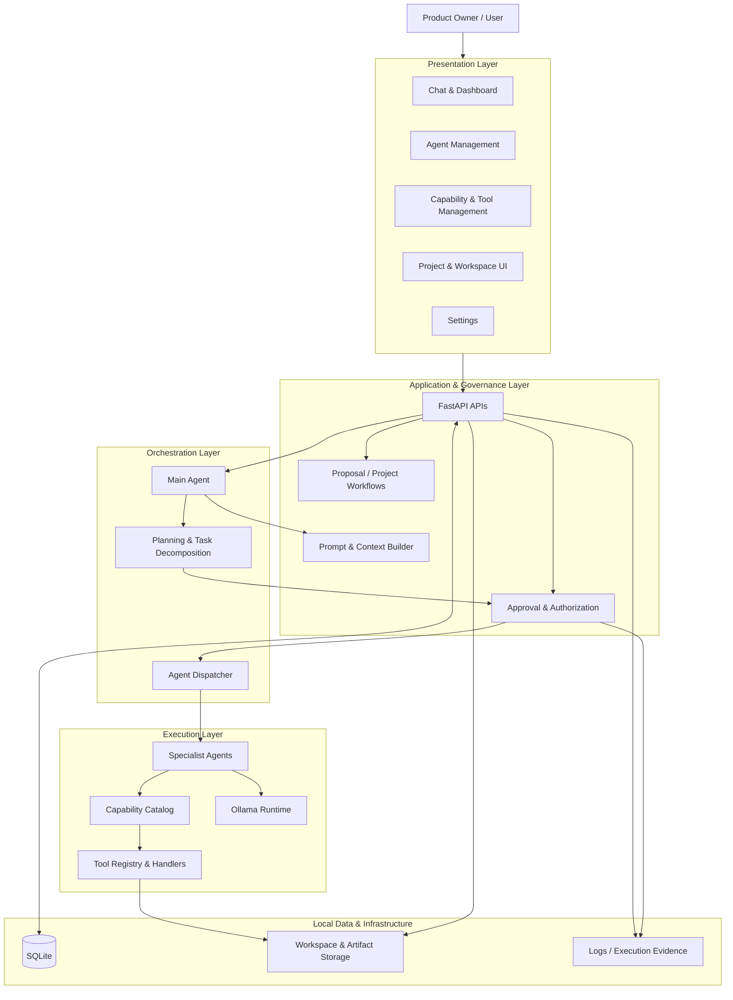
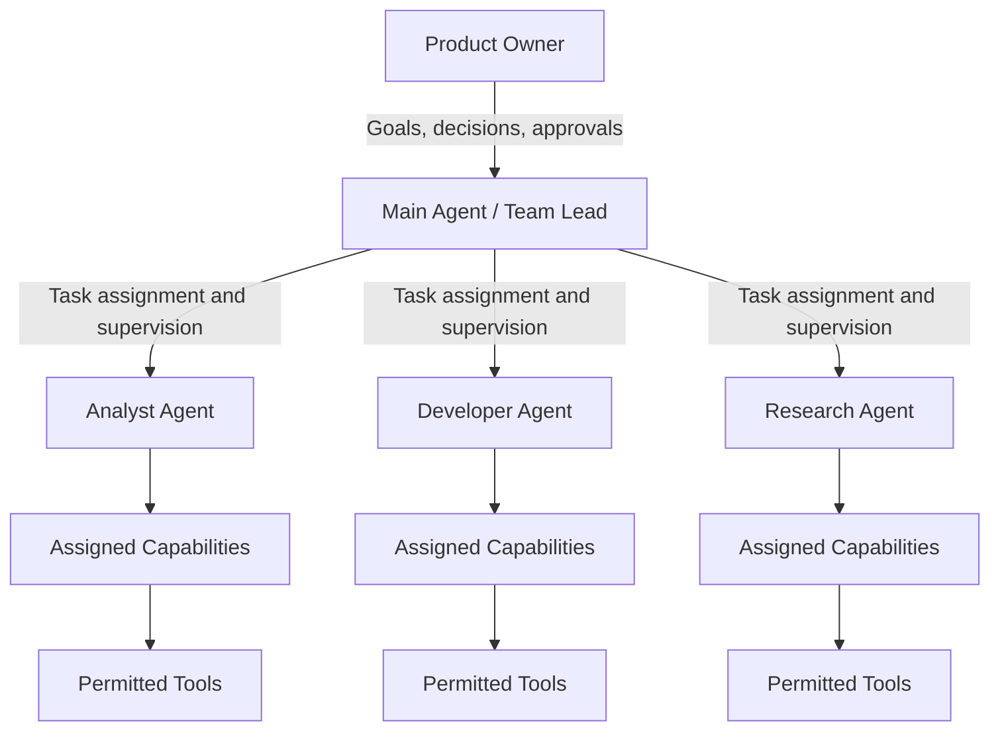
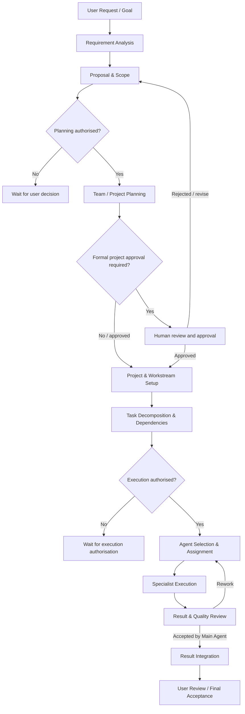
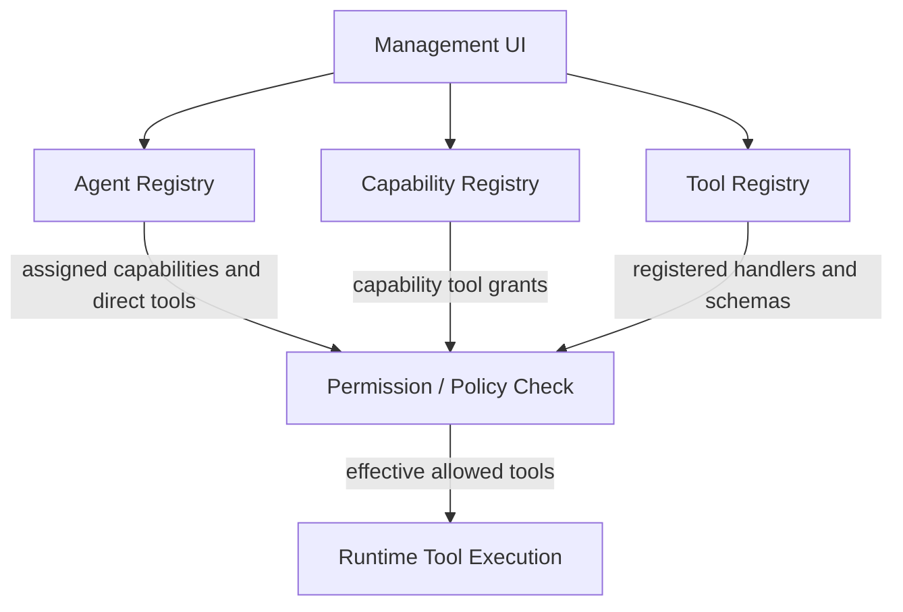
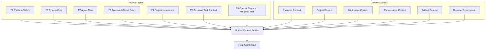
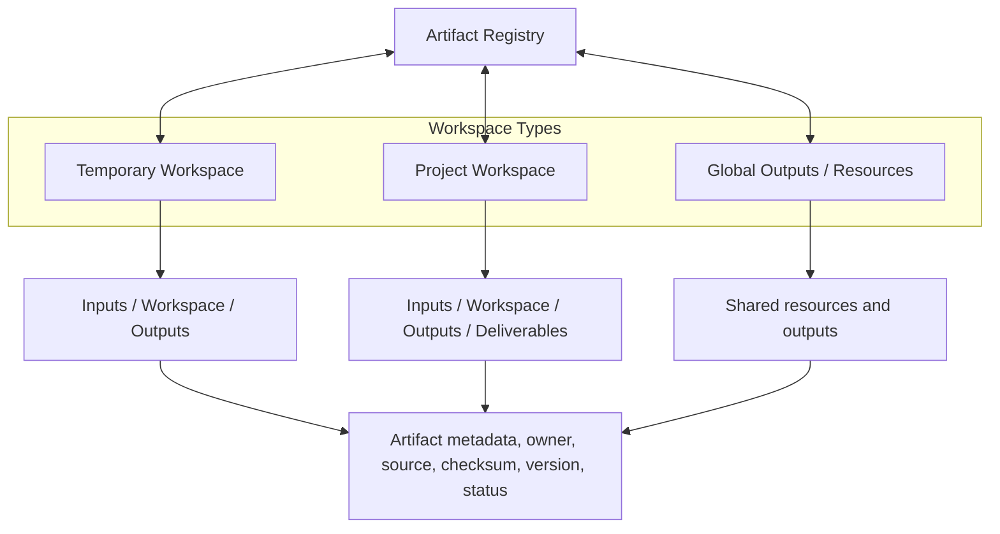

# LocalAgentUI Architecture Overview

This document describes the intended logical architecture and the major mechanisms represented in the current codebase. It is not a claim that every planned capability is fully implemented. See the source modules and release notes for implementation detail.

## 1. Overall system architecture



## 2. AI organisation model

The Main Agent acts as a team lead/coordinator. Specialist Agents have bounded roles and assigned capabilities. The user remains responsible for direction and designated approvals.



This is a logical responsibility model, not an unrestricted peer-to-peer agent network. Dispatch does not automatically grant the Main Agent every tool assigned to a Specialist Agent.

## 3. Proposal, project planning and execution workflow



Planning authorisation, formal project approval and execution authorisation are separate business decisions. A goal does not grant blanket permission for every downstream action.

## 4. Capability, Tool and Permission model



The permission resolution rule is:

```text
Effective Tools = (Capability Tools ∪ Direct Tools) − Explicitly Denied Tools
```

Capability describes a business ability; Tool represents an executable operation; Permission determines whether the operation may run in a given scope. Explicit Deny takes precedence over inherited and direct grants.

## 5. Prompt and context construction

Prompt layers and context sources are related but different concepts. P0–P6 represent instruction layers. Context Builder resolves relevant runtime, business, project, workspace, conversation and artifact information for a specific invocation.



## 6. Workspace and Artifact model



Artifact registration is separate from file creation. The backend should verify file existence and workspace path containment before exposing a registered download.

## 7. Governance concepts

- **Goal Authority:** permission to pursue a defined objective or begin planning.
- **Task Authority:** permission to carry out an approved task or work package.
- **Action Authority:** permission to perform a specific operation, especially where risk, external impact or irreversibility is involved.
- **Human approval:** required at configured decision gates; approval state must be persisted and checked by the backend.
- **Execution evidence:** record actual operations and results; an agent's natural-language statement is not execution evidence by itself.

## Implementation status

These diagrams describe the current design model. Some elements are implemented in the current codebase; others remain experimental or planned. Consult `docs/releases/`, `CHANGELOG.md` and the relevant source modules before relying on a feature.
